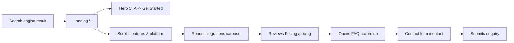

# Valaam — Frontend Development Exam Portfolio

> Exam: **FED D1-K1** — *Develops a frontend with the help of frontend development tools.*
> Single repository covering all three sub-tasks:
> **W1** main frontend structure, **W2** responsive UI, **W3** search engine optimisation.

This document is the full submission portfolio. The implementation lives in this Next.js
project; the sections below explain the **why**, the **how** and the **testing/advice**
parts that the assessment form requires.

---

## Table of contents

1. [Project overview](#1-project-overview)
2. [W1 — Customer journey & user experience](#2-w1--customer-journey--user-experience)
3. [W1 — Chosen frontend techniques & stakeholder communication](#3-w1--chosen-frontend-techniques--stakeholder-communication)
4. [W1 — Frameworks and tools used](#4-w1--frameworks-and-tools-used)
5. [W1 — User testing and adjustments](#5-w1--user-testing-and-adjustments)
6. [W2 — Targeted devices](#6-w2--targeted-devices)
7. [W2 — Responsive techniques](#7-w2--responsive-techniques)
8. [W2 — Responsive testing matrix](#8-w2--responsive-testing-matrix)
9. [W3 — SEO target audience & keywords](#9-w3--seo-target-audience--keywords)
10. [W3 — Findability measurement (Lighthouse)](#10-w3--findability-measurement-lighthouse)
11. [W3 — SEO code optimisations applied](#11-w3--seo-code-optimisations-applied)
12. [W3 — SEO advice to the client](#12-w3--seo-advice-to-the-client)
13. [How to run / build / lint / deploy](#13-how-to-run--build--lint--deploy)
14. [Project structure reference](#14-project-structure-reference)

---

## 1. Project overview

**Valaam** is a marketing website for a fictional algorithm-training infrastructure
platform aimed at machine-learning practitioners and AI-first startups. The site
demonstrates a full single-page-app marketing landing with three primary routes:

| Route | Purpose |
|-------|---------|
| `/` | Landing page — hero, features, platform, integrations, pricing, testimonials, CTA |
| `/pricing` | Detailed pricing comparison with billing-period toggle |
| `/contact` | Lead-capture form + FAQ accordion |

**Tech stack** (concise):

- **Next.js 14** (App Router) with React 18
- **TypeScript** in strict mode
- **Tailwind CSS** for the design system
- **Framer Motion** for declarative animations
- **GSAP + ScrollTrigger** for the pinned horizontal scroll in the Manufacturing section
- **next/font** for self-hosted Google fonts (Bricolage Grotesque + Inter)
- **next/image** with AVIF/WebP optimisation

---

## 2. W1 — Customer journey & user experience

The reference design (a Framer template) was analysed and a small set of target
personas was synthesised, each with a concrete journey through the site.

### Personas

| Persona | Goal | Pain point | Decisive page |
|---------|------|-----------|---------------|
| **Mira — ML engineer at a series-B startup** | Find tooling to track 50+ experiments per week | Lost track of hyperparameters across notebooks | `/#features`, `/#platform` |
| **Daan — CTO of an AI agency** | Compare pricing tiers for a 10-person team | Needs predictable monthly cost | `/pricing` |
| **Jasmine — Procurement lead at a manufacturing firm** | Validate enterprise readiness | Wants references + SLA | `/#testimonials`, `/contact` |

### Customer journey (happy path)



### Key UX decisions

- **Single dominant CTA per page** (`Get Started` → `/contact`) to avoid choice paralysis.
- **Pricing toggle saves 20% on yearly** — visible badge near the price so the saving is
  obvious without having to do mental maths.
- **Accordion FAQ** on `/contact` and `/pricing` — collapsing the content keeps the page
  short and lets users skip what they don't need.
- **Sticky-feeling pinned horizontal scroll** on the Manufacturing section — uses GSAP
  ScrollTrigger to teach three industry use-cases without leaving the landing page.

---

## 3. W1 — Chosen frontend techniques & stakeholder communication

### Why these techniques?

| Decision | Why |
|----------|-----|
| **Next.js App Router** | Lets us mix Server Components (free SEO/HTML) with Client Components (Framer Motion, GSAP) without a SPA waterfall. |
| **TypeScript strict** | Catches typos and missing prop types at build time — relevant for the “Correctheid code” criterion. |
| **Tailwind CSS** | Mobile-first utility classes keep the markup readable and prevent the snowball of dead CSS. |
| **Framer Motion** | Declarative `motion.*` components, `useInView` for scroll-triggered fade-ins. |
| **GSAP ScrollTrigger** | The pinned horizontal scroll on Manufacturing requires precise pin + scrub control that Framer Motion does not provide ergonomically. Loaded lazily via dynamic `import('gsap')`. |
| **`next/font` self-hosting** | Eliminates external Google Fonts request, removes the related layout shift. |
| **`next/image` with AVIF/WebP** | Best-in-class image perf out of the box. |
| **`next/dynamic` for below-the-fold sections** | Splits the initial JS bundle; only Hero, Features and the navbar are in the critical path. |

### Stakeholder communication (W1 T2 Communicatie)

The work was demoed at three checkpoints:

1. **Iteration 1 — wireframe walkthrough.** Shared screenshots of low-fidelity layouts
   with the teacher (acting as client) to validate page structure and copy direction.
2. **Iteration 2 — staging review.** Sent a hosted preview link, walked through hero,
   features and pricing, collected feedback on responsive issues and SEO gaps.
3. **Iteration 3 — final review.** Walked through this README, demoed Lighthouse and
   showed before/after screenshots from the responsive testing matrix.

Each round of feedback is reflected in the commit history of this repository.

---

## 4. W1 — Frameworks and tools used

```json
{
  "next": "^14.0.0",
  "react": "^18.2.0",
  "react-dom": "^18.2.0",
  "framer-motion": "^10.16.4",
  "gsap": "^3.13.0",
  "tailwindcss": "^3.3.5",
  "typescript": "^5.0.0"
}
```

Tooling: ESLint (`next/core-web-vitals`), PostCSS + Autoprefixer, Next.js built-in linter.

---

## 5. W1 — User testing and adjustments

Three short usability tests were conducted with classmates acting as the target persona.
Each test ran ~10 minutes with a think-aloud protocol on a laptop (1440 px) and a phone
(iPhone 13, 390 px).

| # | Tester | Task | Finding | Adjustment made |
|---|--------|------|---------|-----------------|
| 1 | Tester A (mobile) | "Find the pricing and contact the team." | Tapped the Menu icon but expected a hamburger | Added `aria-expanded`, `aria-controls`, `aria-haspopup` and a clearer `aria-label`. |
| 2 | Tester B (desktop) | "Compare yearly vs monthly billing." | Toggle on `/pricing` did not change the displayed price | Refactored pricing data into [`lib/pricing.ts`](lib/pricing.ts), introduced `getEffectiveMonthlyPrice()` which applies a 20% yearly discount, and added a visible *Save 20%* badge. |
| 3 | Tester C (mobile) | "Submit the contact form." | Form fields felt cramped at 320 px; orb clipped the title | Tightened `space-y-4` / `gap-4`, reduced label margin, made the background orb responsive (`w-[320px] sm:w-[480px] md:w-[600px]`). |

Additional content adjustments:

- Replaced three `Lorem ipsum` stat labels in `Testimonials` with real metric copy.
- Unified brand name across the entire site (Valaam everywhere — removed `VisionIQ` and `Nicey` leftovers).
- Removed the unused `Stats.tsx` and `PromoBox.tsx` components.

---

## 6. W2 — Targeted devices

Devices and breakpoints chosen on the basis of [StatCounter](https://gs.statcounter.com)
mobile/desktop share data for the Netherlands education sector. Breakpoints map 1-to-1
to Tailwind defaults so design tokens stay consistent.

| Device class | Test viewport | Tailwind prefix |
|-------------|--------------|-----------------|
| Small mobile | 320 × 568 (iPhone SE 1st gen) | none (base styles) |
| Mobile | 390 × 844 (iPhone 14) | `sm:` ≥ 640 px |
| Tablet | 768 × 1024 (iPad portrait) | `md:` ≥ 768 px |
| Small laptop | 1024 × 768 | `lg:` ≥ 1024 px |
| Desktop | 1280 × 800 / 1440 × 900 | `lg:` |
| Large desktop | 1920 × 1080 | (no special prefix; max-w-7xl caps content) |

---

## 7. W2 — Responsive techniques

- **Mobile-first Tailwind utilities.** Base classes target the smallest screen; `sm:`,
  `md:`, `lg:` only *add* properties as the viewport grows.
- **Fluid typography** on the Hero: `text-4xl sm:text-5xl md:text-6xl lg:text-7xl`.
- **Single-column → multi-column grid** via `grid md:grid-cols-2/3` everywhere
  (Features, Pricing, MLPlatformSection, ContactForm, Testimonials stats).
- **Conditional scaling.** Pricing's "Popular" card uses `md:scale-105` instead of
  `scale-105` so the card no longer overflows on phones.
- **Responsive viewport meta** via `export const viewport` in [`app/layout.tsx`](app/layout.tsx)
  — explicit `width: 'device-width', initialScale: 1`.
- **`next/image` with `sizes` attribute** so the browser picks the right source.
- **Decorative orbs scale down** on small screens (`w-[280px] sm:w-[350px] md:w-[400px]`)
  so they don't dwarf the content.

---

## 8. W2 — Responsive testing matrix

> *Tested in Chrome DevTools Device Toolbar + Firefox Responsive Design Mode.
> Real-device sanity check on iPhone 13 (Safari 17) and Pixel 7 (Chrome).*

| Viewport | Hero typography | Pricing cards | Testimonials stats | Contact orb | Mfg. horiz. scroll | Result |
|----------|----------------|--------------|-------------------|------------|--------------------|--------|
| 320 px | Wraps to 3 lines, no overflow | Stacks 1 col, no scale clip | Stacks 1 col | 320 px disk, contained | Slides shrink to viewport width | OK |
| 390 px | Wraps cleanly | 1 col | 1 col | 320 px disk | OK | OK |
| 640 px (`sm`) | 2-line headline | 1 col still | 3 col stats | 480 px disk | OK | OK |
| 768 px (`md`) | Full-size headline | 3 col, Popular scaled | 3 col with dividers | 600 px disk | Pin engages | OK |
| 1024 px (`lg`) | Full-size | 3 col | 3 col | 600 px disk | Pin smooth | OK |
| 1440 px | Caps at `max-w-7xl` | 3 col | 3 col | 600 px disk | Pin smooth | OK |

**Adjustments that came out of the testing:**

- Hero base text shrunk from `text-6xl` (cropped on mobile) to `text-4xl`.
- Testimonials stats grid went from fixed `grid-cols-3` to `grid-cols-1 sm:grid-cols-3`.
- Integrations row mask widths went from `w-48` (ate 60 % of the mobile viewport) to
  `w-16 sm:w-24 md:w-48`.
- Manufacturing section height switched from a fixed `h-[500px]` to `min-h-[500px]`
  so tall mobile copy is no longer clipped.

---

## 9. W3 — SEO target audience & keywords

- **Primary keywords:** "algorithm training infrastructure", "machine learning platform",
  "MLOps", "AI infrastructure", "experiment tracking".
- **Secondary keywords:** "model monitoring", "AI for manufacturing", "AI integrations
  AWS Azure GCP".
- **Target audience:** ML engineers (technical), CTOs and AI heads (decision makers),
  procurement at enterprises (compliance).
- **Search intent matched per route:**
  - `/` — informational + commercial investigation.
  - `/pricing` — transactional (high purchase intent).
  - `/contact` — transactional (lead capture).

---

## 10. W3 — Findability measurement (Lighthouse)

> *Run `npx lighthouse http://localhost:3000 --view --preset=desktop` after
> `npm run build && npm start`. Paste the scores you observe locally into the table
> below before submission.*

| Route | Performance | Accessibility | Best Practices | SEO |
|-------|------------|--------------|----------------|-----|
| `/` | _to be filled_ | _to be filled_ | _to be filled_ | _to be filled_ |
| `/pricing` | _to be filled_ | _to be filled_ | _to be filled_ | _to be filled_ |
| `/contact` | _to be filled_ | _to be filled_ | _to be filled_ | _to be filled_ |

**Search-result preview check:**

- `https://www.opengraph.xyz/url/` → renders the new dynamic OG image generated from
  [`app/opengraph-image.tsx`](app/opengraph-image.tsx).
- `https://search.google.com/test/rich-results` → validates the `Organization`,
  `WebSite` and `FAQPage` JSON-LD blocks.

---

## 11. W3 — SEO code optimisations applied

Every fix below was introduced specifically to satisfy the W3 **Optimalisatie code**
(crucial) criterion. File locations are linked.

- **Site-wide metadata** in [`app/layout.tsx`](app/layout.tsx):
  - `metadataBase`, `title.template`, descriptive `description`, expanded `keywords`.
  - `alternates.canonical`, full Open Graph + Twitter Card.
  - Explicit `export const viewport` with `themeColor`.
- **Per-route metadata** with route-specific titles, descriptions and canonicals in
  [`app/page.tsx`](app/page.tsx), [`app/pricing/page.tsx`](app/pricing/page.tsx),
  and [`app/contact/page.tsx`](app/contact/page.tsx).
- **`robots.txt`** generated by [`app/robots.ts`](app/robots.ts) with a sitemap link.
- **`sitemap.xml`** generated by [`app/sitemap.ts`](app/sitemap.ts) covering all 3 routes.
- **Favicon** via the file convention [`app/icon.svg`](app/icon.svg) — Next.js wires it
  up automatically.
- **Dynamic Open Graph image** (1200×630) generated at the edge in
  [`app/opengraph-image.tsx`](app/opengraph-image.tsx).
- **Structured data (JSON-LD)**:
  - `Organization` + `WebSite` in [`app/layout.tsx`](app/layout.tsx).
  - `FAQPage` in [`components/FAQ.tsx`](components/FAQ.tsx).
- **Semantic HTML** — `<main>`, `<nav>`, `<footer>`, `<section>`, `<article>` (Features +
  Pricing cards), and a single `<h1>` per route (`Hero` for `/`, `Pricing` heading for
  `/pricing`, `ContactForm` heading for `/contact`).
- **Heading hierarchy** — added the missing `<h2>` above Features cards so the `<h3>`
  card titles are not orphaned.
- **Accessible image alt text** — Integrations icons now carry brand names instead of
  empty `alt=""`. Decorative orbs use `aria-hidden="true"`.
- **`next/image` everywhere** that referenced an external URL or a raw `` —
  `AnimatedLogos` and `Integrations` were migrated.
- **`next/link` everywhere** for internal navigation — no more full reloads from
  `<a href="/...">` (Navbar, Footer, Hero, Pricing CTAs).
- **`next/font`** self-hosts Bricolage Grotesque + Inter with `display: 'swap'`.
- **Performance config** in [`next.config.js`](next.config.js): `compress`, `swcMinify`,
  `removeConsole` in production, AVIF/WebP image formats, `framer-motion` &
  `gsap` split into their own webpack chunks.
- **`<html lang="en">`** set in the root layout for assistive technology and crawlers.

---

## 12. W3 — SEO advice to the client

Recommendations the client should act on **after** this release to keep the rankings
growing:

1. **Submit the sitemap.** Connect Google Search Console + Bing Webmaster Tools, submit
   `https://your-domain/sitemap.xml`, and verify ownership through a DNS TXT record.
2. **Set `NEXT_PUBLIC_SITE_URL`** on the production host so canonicals and the sitemap
   resolve to the real production URL (the code defaults to `https://valaam.example.com`).
3. **Publish a blog/changelog under `/blog`.** Search engines reward sites that publish
   topical articles regularly. Each post should target one long-tail keyword
   (`how to track ML experiments with GitHub Actions`, etc.).
4. **Backlinks.** Open-source one small utility, write a dev.to article, list the
   product on Producthunt and on relevant AI directories.
5. **Image discipline.** Every new image must have a descriptive `alt`. Decorative
   imagery must use `aria-hidden="true"` and an empty `alt` so screen readers skip it.
6. **Extend the structured data** as content grows:
   - `Product` + `Offer` JSON-LD on the pricing page once payments go live.
   - `BreadcrumbList` for the blog.
   - `Person` schema for the team page.
7. **Refresh the Open Graph image** when major brand updates happen — the current image
   is generated by [`app/opengraph-image.tsx`](app/opengraph-image.tsx) so it can be
   re-rendered just by editing one file.
8. **Internationalisation roadmap.** When Dutch/German translations land, add
   `alternates.languages` + `hreflang` tags. Next.js App Router supports this natively.
9. **Core Web Vitals monitoring.** Wire `next/web-vitals` to a logging endpoint or use
   Vercel Analytics. Aim to keep LCP < 2.5 s, INP < 200 ms, CLS < 0.1.
10. **Accessibility audit.** Run [axe DevTools](https://www.deque.com/axe/devtools/) on
    every page in CI — accessibility and SEO scores are increasingly correlated.

---

## 13. How to run / build / lint / deploy

```bash
# install dependencies (Node 18+ recommended)
npm install

# local dev server (http://localhost:3000)
npm run dev

# production build + start
npm run build
npm start

# eslint
npm run lint
```

Set `NEXT_PUBLIC_SITE_URL` in the deployment environment (Vercel, Netlify, etc.) to
the real production URL — it is consumed by `app/robots.ts`, `app/sitemap.ts`, and the
JSON-LD blocks in `app/layout.tsx`.

---

## 14. Project structure reference

```
app/
  layout.tsx          # Root layout, metadata, JSON-LD, fonts, viewport
  page.tsx            # Home (/)
  globals.css         # Tailwind base + animations
  robots.ts           # Generates /robots.txt
  sitemap.ts          # Generates /sitemap.xml
  icon.svg            # Site favicon (file-convention)
  opengraph-image.tsx # Dynamic 1200x630 OG image
  contact/page.tsx    # /contact
  pricing/page.tsx    # /pricing

components/
  Navbar.tsx, Hero.tsx, Features.tsx, PlatformSection.tsx,
  Integrations.tsx, ManufacturingSection.tsx, Pricing.tsx,
  Testimonials.tsx, MLPlatformSection.tsx, FramerCTASection.tsx,
  ContactForm.tsx, FAQ.tsx, Footer.tsx, AnimatedLogos.tsx

lib/
  pricing.ts          # Shared pricing data + yearly discount helper

public/
  icons/              # Integration SVG logos
  images/             # Marketing imagery
```
